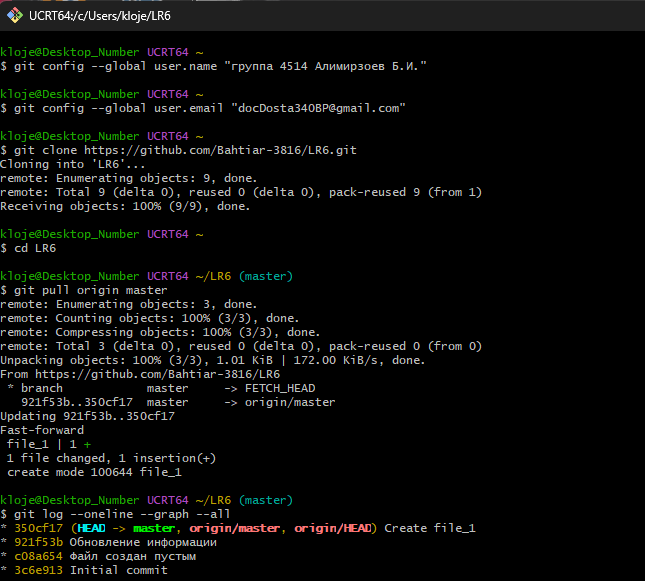
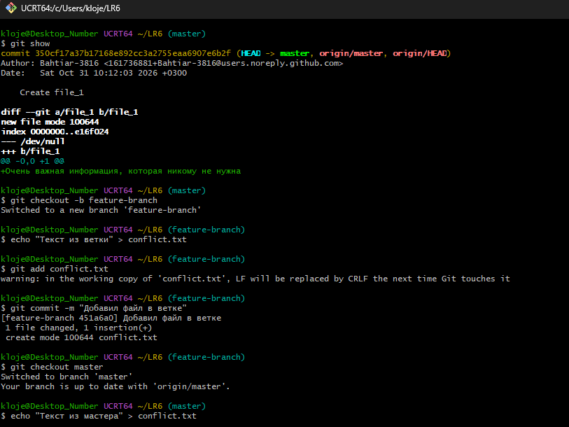
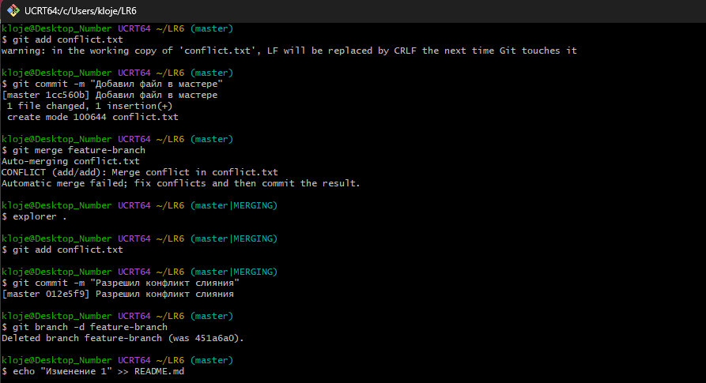
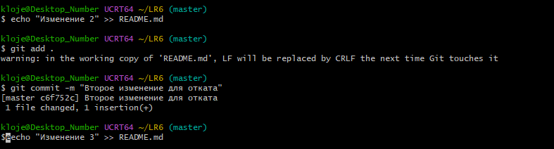
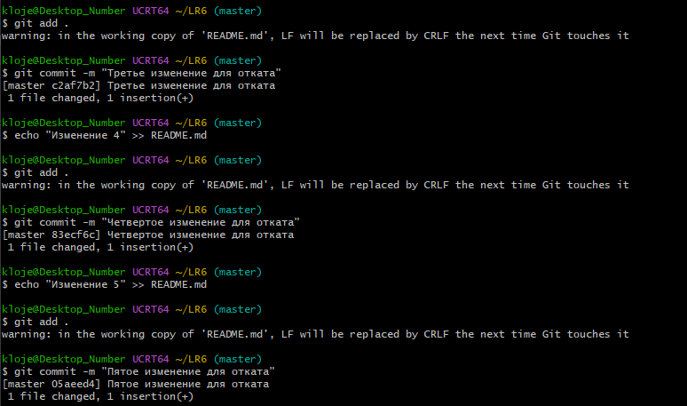
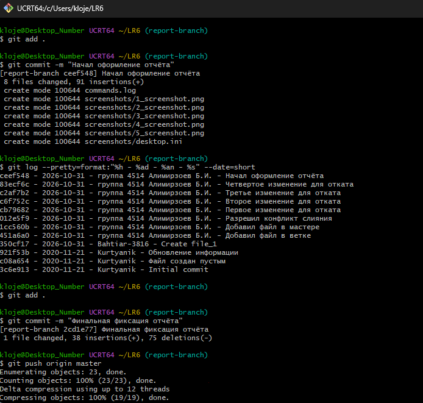

# LR6
Лабораторная работа №6

Для начала нужно выставить никнейм, а после этого клонировать репозиторий локально, 
чтобы можно было с ним полноценно работать.



После этого посмотрим последний коммит, как следует по заданию через команду show.
Далее создадим свою ветку, которую в дальнейшем удалим после слияния с основной.
После этого продемонстрируем конфликт, разрешим его после.
Чтобы сымитировать конфликт, создадим ветку, изменим файл,
а потом вернёмся в master и изменим тот же файл по-другому




После этого Git выдаст ошибку конфликта.
Откроем файл conflict.txt в блокноте и удалим маркеры <<<<<<<, =======, >>>>>>.
Оставим нужный текст, удалим маркеры и сохраним файл.
Далее конфликт разрешится после этого при повторном запуске.
После этого сделаем коммиты для примера.





Производим финальный комит.
Получаем историю операций в форматированном виде (сокращённый
хэш + дата + имя автора + комментарий)

ceef548 - 2026-10-31 - группа 4514 Алимирзоев Б.И. - Начал оформление отчёта
83ecf6c - 2026-10-31 - группа 4514 Алимирзоев Б.И. - Четвертое изменение для отката
c2af7b2 - 2026-10-31 - группа 4514 Алимирзоев Б.И. - Третье изменение для отката
c6f752c - 2026-10-31 - группа 4514 Алимирзоев Б.И. - Второе изменение для отката
cb79682 - 2026-10-31 - группа 4514 Алимирзоев Б.И. - Первое изменение для отката
012e5f9 - 2026-10-31 - группа 4514 Алимирзоев Б.И. - Разрешил конфликт слияния
1cc560b - 2026-10-31 - группа 4514 Алимирзоев Б.И. - Добавил файл в мастере
451a6a0 - 2026-10-31 - группа 4514 Алимирзоев Б.И. - Добавил файл в ветке
350cf17 - 2026-10-31 - Bahtiar-3816 - Create file_1
921f53b - 2020-11-21 - Kurtyanik - Обновление информации
c08a654 - 2020-11-21 - Kurtyanik - Файл создан пустым
3c6e913 - 2020-11-21 - Kurtyanik - Initial commit




### Лог команд
```text
git config --global user.name "группа 4514 Алимирзоев Б.И."
git config --global user.email "мой email"
git clone https://github.com/Bahtiar-3816/LR6.git
cd LR6
git pull origin master
git log --oneline --graph --all
git show
git checkout -b feature-branch
echo "Текст из ветки" > conflict.txt
git add conflict.txt
git commit -m "Добавил файл в ветке"
git checkout master
echo "Текст из мастера" > conflict.txt
git add conflict.txt
git commit -m "Добавил файл в мастере"
git merge feature-branch
git add conflict.txt
git commit -m "Разрешил конфликт слияния"
git branch -d feature-branch
echo "Изменение 1" >> README.md
git add .
git commit -m "Первое изменение для отката"
echo "Изменение 2" >> README.md
git add .
git commit -m "Второе изменение для отката"
eecho "Изменение 3" >> README.md
git add .
git commit -m "Третье изменение для отката"
echo "Изменение 4" >> README.md
git add .
git commit -m "Четвертое изменение для отката"
git reset --soft HEAD~1
git checkout -b report-branch
git add .
git commit -m "Начал оформление отчёта"
git log --pretty=format:"%h - %ad - %an - %s" --date=short
git add .
git commit -m "Финальная фиксация отчёта"
'''
